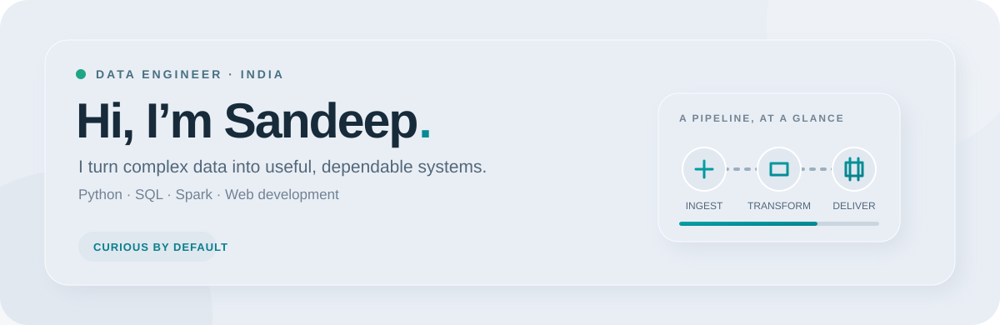



  

  &nbsp;&nbsp;
  &nbsp;&nbsp;
  &nbsp;&nbsp;
  

  

## The short version

I’m Sandeep — a **Data Engineer from India** who enjoys turning messy, moving data into systems people can trust. I work across data engineering and web development, and I’m always curious about the details that make a pipeline dependable in production.

> **Build with curiosity. Ship with care. Keep learning.**

- **Currently learning:** PySpark, Django, and data engineering certification topics
- **Ask me about:** Python, SQL, Linux, data engineering, and web development
- **Away from the terminal:** books, music, and a good internet rabbit hole
- **Pronouns:** He/Him

## What I work with

  <code></code>
  <code></code>
  <code></code>
  <code></code>
  <code></code>
  <code></code>
  <code></code>
  <code></code>
  <code></code>
  <code></code>

## Writing about data

I’m documenting my journey from Spark fundamentals to production-ready data engineering. The latest posts are pulled in automatically, so this section stays fresh.

<!-- BLOG-POST-LIST:START -->
- [Day 30: From Zero to Production-Ready Spark Data Engineer](https://dev.to/sandeepk27/day-30-from-zero-to-production-ready-spark-data-engineer-f6f)
- [Day 29: Building a Production-Grade Real-Time ETL Pipeline with Spark &amp; Delta](https://dev.to/sandeepk27/day-29-building-a-production-grade-real-time-etl-pipeline-with-spark-delta-4blc)
- [Day 28: Spark Streaming Performance Tuning](https://dev.to/sandeepk27/day-28-spark-streaming-performance-tuning-37ig)
- [Day 27: Building Exactly-Once Streaming Pipelines with Spark &amp; Delta Lake](https://dev.to/sandeepk27/day-27-building-exactly-once-streaming-pipelines-with-spark-delta-lake-243c)
- [Day 26: Spark Streaming Joins](https://dev.to/sandeepk27/day-26-spark-streaming-joins-2kdj)
<!-- BLOG-POST-LIST:END -->

## The GitHub activity

  

  
  

  

## Currently on repeat

  

## A little more persistence

When I’m not building pipelines, the contribution snake is busy making its way across my GitHub graph.

<i>“To live a creative life, we must lose our fear of being wrong.”</i>

